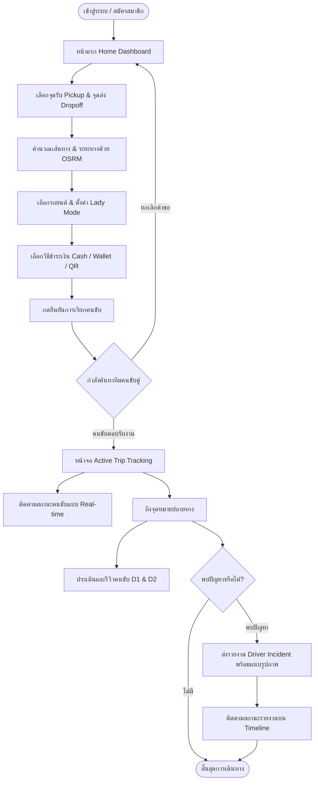

# 🚗 SafeSeat Mini — Passenger Mobile Application

<div align="center">


### **Designated Driver & Safety On-Demand Service Platform**
**แพลตฟอร์มบริการคนขับรถแทนผู้โดยสารเพื่อความปลอดภัยบนท้องถนน**  
*เมาไม่ขับ กลับบ้านปลอดภัยด้วยรถของคุณเอง พร้อมทีมคนขับคู่มืออาชีพและการดูแลระดับมาตรฐาน*

---

[](https://flutter.dev)
[](https://dart.dev)
[](https://riverpod.dev)
[](https://supabase.com)
[](https://flutter.dev)
[](#)

</div>

---

## 📖 สารบัญ (Table of Contents)

- [📌 ภาพรวมของระบบ (Overview)](#-ภาพรวมของระบบ-overview)
- [👥 แนวคิดทีมคนขับแบบคู่ (Dual-Driver Model)](#-แนวคิดทีมคนขับแบบคู่-dual-driver-model)
- [✨ ฟีเจอร์หลัก (Key Features)](#-ฟีเจอร์หลัก-key-features)
- [🗺️ ขั้นตอนการทำงานของผู้ใช้ (User Journey Flow)](#️-ขั้นตอนการทำงานของผู้ใช้-user-journey-flow)
- [🏗️ สถาปัตยกรรมและโครงสร้างโค้ด (Architecture & Codebase)](#️-สถาปัตยกรรมและโครงสร้างโค้ด-architecture--codebase)
- [🛠️ เทคโนโลยีและไลบรารีที่ใช้ (Tech Stack)](#️-เทคโนโลยีและไลบรารีที่ใช้-tech-stack)
- [⚙️ การตั้งค่าสภาพแวดล้อม (Environment Configuration)](#️-การตั้งค่าสภาพแวดล้อม-environment-configuration)
- [🚀 การติดตั้งและเริ่มใช้งาน (Getting Started)](#-การติดตั้งและเริ่มใช้งาน-getting-started)
- [📱 สิทธิ์การเข้าถึงอุปกรณ์ (App Permissions)](#-สิทธิ์การเข้าถึงอุปกรณ์-app-permissions)
- [🎨 ระบบการออกแบบ (Design System & UI Tokens)](#-ระบบการออกแบบ-design-system--ui-tokens)

---

## 📌 ภาพรวมของระบบ (Overview)

**SafeSeat Mini** คือโมบายล์แอปพลิเคชันสำหรับผู้โดยสาร (Client App) ในระบบบริการคนขับรถแทน (Designated Driver Service) ซึ่งถูกพัฒนาขึ้นเพื่อแก้ปัญหาอุบัติเหตุจากการเมาแล้วขับ ความเหนื่อยล้าจากการเดินทาง หรือผู้ที่ต้องการความสะดวกสบายในการเดินทางกลับที่พักโดยใช้รถยนต์ส่วนบุคคลของตนเอง

ระบบ SafeSeat Mini เชื่อมต่อกับ Backend RESTful API และ Supabase Cloud Platform เพื่ออำนวยความสะดวกตั้งแต่การระบุพิกัดบนแผนที่ การคำนวณเส้นทางและประเมินราคา การติดตามการเดินทางแบบ Real-time จนกระทั่งถึงจุดหมายปลายทาง พร้อมระบบความปลอดภัยและการตรวจสอบคุณภาพการให้บริการอย่างครอบคลุม

---

## 👥 แนวคิดทีมคนขับแบบคู่ (Dual-Driver Model)

หนึ่งในเอกลักษณ์ของแพลตฟอร์ม SafeSeat คือการจัดส่งทีมคนขับแบบเป็นคู่ (**Dual-Driver Operations**) เพื่อความปลอดภัยและความคล่องตัวสูงสุด:

```text
       ┌────────────────────────┐
       │     ลูกค้านั่งในรถ     │
       │   (รถยนต์ส่วนตัวลูกค้า)  │
       └───────────┬────────────┘
                   │
    ┌──────────────┴──────────────┐
    │                             │
    ▼                             ▼
┌─────────────────────────┐   ┌─────────────────────────┐
│   Leader Driver (D1)    │   │   Follower Driver (D2)  │
│       คนขับหลัก          │   │      คนขับผู้ติดตาม      │
│ ─────────────────────── │   │ ─────────────────────── │
│ ทำหน้าที่ขับรถของลูกค้า   │   │ ขี่มอเตอร์ไซค์ตามขบวน   │
│ นำส่งลูกค้าและรถยนต์      │   │ คอยดูแลความปลอดภัย      │
│ ถึงจุดหมายอย่างปลอดภัย    │   │ และรับ D1 กลับหลังจบทริป │
└─────────────────────────┘   └─────────────────────────┘
```

- **Leader Driver (D1 - คนขับหลัก):** พนักงานขับรถมืออาชีพที่ได้รับมอบหมายให้ขึ้นไปขับขี่รถยนต์ส่วนบุคคลของลูกค้า
- **Follower Driver (D2 - ผู้ติดตาม):** ขับขี่รถจักรยานยนต์ติดตามขบวนรถ เพื่อสังเกตการณ์ความปลอดภัย อำนวยความสะดวกในเส้นทาง และรับคนขับหลักเดินทางกลับหลังจากส่งผู้โดยสารถึงจุดหมายอย่างปลอดภัย
- **ระบบประเมินอิสระ (Independent Rating):** ผู้โดยสารสามารถให้คะแนนและติชมคนขับทั้งสองคนแยกจากกันได้อย่างเป็นธรรม

---

## ✨ ฟีเจอร์หลัก (Key Features)

### 1. 🗺️ การค้นหาตำแหน่งและคำนวณเส้นทางอัจฉริยะ (Smart Location & Booking)
- **Interactive OpenStreetMap:** ใช้งาน `flutter_map` ร่วมกับ OpenStreetMap ปักหมุดเลือกจุดรับ (Pickup) และจุดส่ง (Dropoff) ได้อย่างลื่นไหล
- **GPS Current Location:** ดึงตำแหน่งปัจจุบันของผู้ใช้ด้วย `geolocator`
- **Reverse Geocoding:** แปลงพิกัดละติจูด/ลองจิจูดเป็นชื่อสถานที่และที่อยู่ภาษาไทยผ่าน OpenStreetMap Nominatim
- **OSRM Driving Route Engine:** เชื่อมต่อกับ Project OSRM Routing API เพื่อคำนวณเส้นทางเดินรถจริง ระยะทางกิโลเมตร และระยะเวลาเดินทางโดยประมาณ (ETA)
- **Quick Home Pinning:** บันทึกพิกัดบ้านไว้ในโปรไฟล์ เพื่อกดเลือกปลายทาง "กลับบ้านทันที" ได้ในคลิกเดียว

### 2. 🛡️ ความปลอดภัยและความต้องการเฉพาะบุคคล (Safety & Preferences)
- **Lady Mode (โหมดผู้หญิง):** สวิตช์เปิดใช้งานสำหรับผู้โดยสารสตรีที่ต้องการขอรับบริการเฉพาะทีมคนขับผู้หญิง เพื่อความสบายใจและความปลอดภัยสูงสุด
- **Vehicle Profiles:** บันทึกและเลือกรถยนต์ส่วนบุคคลของผู้ใช้ได้หลายคัน (ยี่ห้อ, รุ่น, สี, ป้ายทะเบียน, ประเภทเกียร์ Auto/Manual)
- **Trip Notes:** ช่องกรอกข้อความระบุหมายเหตุพิเศษถึงคนขับ เช่น ประตูทางเข้า จุดสังเกต หรือข้อควรระวังเกี่ยวกับรถ

### 3. 💳 กระเป๋าเงินและวิธีการชำระเงิน (SafeSeat Wallet & Payments)
- **In-App Digital Wallet:** แสดงยอดเงินคงเหลือ เติมเงินเข้ากระเป๋าผ่านระบบชำระเงินแบบไดนามิก
- **Flexible Payment Methods:** เลือกระบบชำระเงินได้ตามความสะดวก:
  - เงินสด (Cash on Delivery)
  - ตัดยอดเงินผ่าน SafeSeat Wallet
  - สแกน QR PromptPay

### 4. 📡 การติดตามสถานะการเดินทางสด (Live Trip Tracking & SOS)
- **Real-Time Trip Lifecycle:**
  `รอรับงาน (Searching)` $\rightarrow$ `คนขับรับงานแล้ว (Matched)` $\rightarrow$ `คนขับกำลังมารับ (Arriving)` $\rightarrow$ `กำลังเดินทาง (In Transit)` $\rightarrow$ `ถึงที่หมายสำเร็จ (Completed)`
- **Live Moving Marker:** แสดงพิกัดและการเคลื่อนที่ของทีมคนขับบนแผนที่สด
- **In-App Direct Contact:** ปุ่มโทรออกหาคนขับหลัก (D1) หรือคนขับผู้ติดตาม (D2) ได้ทันทีผ่านโทรศัพท์
- **Emergency Trip Sharing:** ฟังก์ชันแชร์ลิงก์หรือรายละเอียดการเดินทางปัจจุบัน (พิกัด, ทะเบียนรถ, ชื่อคนขับ) ไปยังแอปภายนอก เช่น LINE หรือ SMS เพื่อให้ครอบครัวและคนใกล้ชิดติดตามได้

### 5. ⭐️ ระบบรีวิวและให้คะแนนคนขับแบบคู่ (Dual-Driver Reviews)
- ให้คะแนนระดับดาว (1 - 5 ดาว) แยกรายบุคคลระหว่าง **Leader Driver (D1)** และ **Follower Driver (D2)**
- เลือกระบุแท็กความประทับใจ (เช่น ขับขี่นุ่มนวล สุภาพ ตรงต่อเวลา) และบันทึกข้อความติชม
- คะแนนจะถูกประมวลผลเพื่อนำไปคำนวณ Rating เฉลี่ยของคนขับแต่ละรายบนระบบ

### 6. 🚨 ระบบรายงานเหตุการณ์และความโปร่งใส (Incident Reporting & Timeline)
- **Multi-Image Evidence:** ถ่ายภาพหรือแนบหลักฐานรูปภาพได้หลายรูปพร้อมกัน อัปโหลดตรงขึ้น Supabase Storage
- **Accused Driver Cards:** แสดงข้อมูล ชื่อนามสกุล รูปโปรไฟล์ และคะแนนของคนขับที่เกี่ยวข้องกับรายงาน
- **Real-time Status Timeline:** ตรวจสอบความคืบหน้าของรายงานได้ตลอดเวลา:
  - 🟡 **ส่งเรื่องแล้ว (Submitted):** ระบบได้รับข้อมูลและหลักฐานเรียบร้อยแล้ว
  - 🔵 **กำลังตรวจสอบ (Under Review):** เจ้าหน้าที่กำลังตรวจสอบข้อมูลร่วมกับทีมคนขับ
  - 🟢 **ดำเนินการเสร็จสิ้น (Resolved):** สรุปผลการสอบสวนและแจ้งผลการดำเนินงานให้ผู้ใช้ทราบ

---

## 🗺️ ขั้นตอนการทำงานของผู้ใช้ (User Journey Flow)



---

## 🏗️ สถาปัตยกรรมและโครงสร้างโค้ด (Architecture & Codebase)

SafeSeat Mini พัฒนาขึ้นโดยยึดตามหลักการ **Feature-First Architecture** ร่วมกับ **Separation of Concerns (SoC)** เพื่อความยืดหยุ่น การทดสอบที่ง่าย และการจัดการ State ที่เป็นระบบด้วย **Riverpod**

```text
safeseat_mini/
├── android/                   # Android native configurations & permissions
├── ios/                       # iOS native configurations & permissions
├── assets/                    # Static Assets (Images, Icons, Fonts)
│   ├── images/
│   │   └── logo.png           # SafeSeat brand logo
│   └── .env                   # Environment variable template
├── lib/
│   ├── core/                  # แกนกลางของระบบที่ใช้ร่วมกันทุกโมดูล
│   │   ├── constants/         # App & API Endpoints Constants (api_constants.dart)
│   │   ├── controllers/       # Global State Notifiers (user_controller.dart)
│   │   ├── services/          # Low-level Services (geocoding_service, route_service)
│   │   ├── theme/             # Design Tokens & Material 3 ThemeData (app_theme.dart)
│   │   ├── utils/             # Helpers (app_feedback, validators)
│   │   └── widgets/           # Global Shared Widgets (driver_avatar, etc.)
│   │
│   ├── data/                  # เลเยอร์ข้อมูลและการสื่อสารเครือข่าย
│   │   ├── models/            # Data Transfer Objects & Schema Models
│   │   │   ├── car_model.dart
│   │   │   ├── driver_report_model.dart
│   │   │   ├── request_driver_model.dart
│   │   │   ├── review_model.dart
│   │   │   └── user_model.dart
│   │   └── repositories/      # Remote HTTP API Data Access Gateways
│   │       ├── auth_repository.dart
│   │       ├── profile_repository.dart
│   │       └── request_driver_repository.dart
│   │
│   ├── features/              # โมดูลฟังก์ชันการทำงานแบ่งตามฟีเจอร์
│   │   ├── auth/              # ระบบเข้าสู่ระบบ และสมัครสมาชิก (Login / Register)
│   │   ├── home/              # แดชบอร์ดหลักและคำแนะนำการใช้งาน (HomeScreen)
│   │   ├── main_layout/       # Navigation Shell และ Bottom Navigation Bar
│   │   ├── request_driver/    # ระบบการเรียกรถ ติดตามการเดินทาง และแผนที่
│   │   │   ├── controllers/   # RequestDriverController & State
│   │   │   ├── request_driver_screen.dart
│   │   │   ├── select_location_screen.dart
│   │   │   ├── request_driver_details_screen.dart
│   │   │   ├── waiting_driver_screen.dart
│   │   │   └── active_trip_screen.dart
│   │   ├── history/           # ประวัติการเดินทาง ระบบรีวิว และระบบรายงานเหตุการณ์
│   │   │   ├── controllers/   # HistoryController & IncidentReportController
│   │   │   ├── history_screen.dart
│   │   │   ├── history_trip_details_screen.dart
│   │   │   ├── history_trip_review_screen.dart
│   │   │   ├── history_trip_report_screen.dart
│   │   │   └── history_report_details_screen.dart
│   │   └── profile/           # จัดการโปรไฟล์ ยานพาหนะ และกระเป๋าเงิน
│   │       ├── controllers/   # ProfileController & WalletController
│   │       ├── profile_screen.dart
│   │       ├── edit_profile_screen.dart
│   │       ├── car_management_screen.dart
│   │       └── wallet_screen.dart
│   │
│   └── main.dart              # Entrypoint, Supabase Initialization & Root ProviderScope
└── pubspec.yaml               # Flutter Package Dependencies & Asset Declarations
```

---

## 🛠️ เทคโนโลยีและไลบรารีที่ใช้ (Tech Stack)

| หมวดหมู่ | เทคโนโลยี / แพ็กเกจ | เวอร์ชัน | คำอธิบายหน้าที่ |
| :--- | :--- | :--- | :--- |
| **Framework** | [Flutter](https://flutter.dev) | SDK ^3.10.4 | เฟรมเวิร์กหลักในการสร้าง Cross-platform Mobile App |
| **Language** | [Dart](https://dart.dev) | 3.x | ภาษาพัฒนาเชิงวัตถุที่มี Type-safety สูง |
| **State Management** | [flutter_riverpod](https://pub.dev/packages/flutter_riverpod) | ^3.3.1 | จัดการ State, Dependency Injection และ Data Flow |
| **BaaS & Storage** | [supabase_flutter](https://pub.dev/packages/supabase_flutter) | ^2.12.4 | อัปโหลดและจัดเก็บภาพหลักฐาน/โปรไฟล์บน Cloud Storage |
| **Map & Geospatial** | [flutter_map](https://pub.dev/packages/flutter_map) | ^8.3.0 | แสดงแผนที่ OpenStreetMap แบบโต้ตอบได้สมบูรณ์ |
| **Coordinates** | [latlong2](https://pub.dev/packages/latlong2) | ^0.9.1 | จัดการพิกัดทางภูมิศาสตร์ ละติจูด/ลองจิจูด |
| **Location Service** | [geolocator](https://pub.dev/packages/geolocator) | ^14.0.2 | อ่านพิกัดปัจจุบันผ่านดาวเทียม GPS ของอุปกรณ์ |
| **Network & REST** | [http](https://pub.dev/packages/http) | ^1.6.0 | สื่อสารกับ RESTful API ของ SafeSeat Backend |
| **Config Loader** | [flutter_dotenv](https://pub.dev/packages/flutter_dotenv) | ^6.0.1 | โหลดตัวแปรสภาพแวดล้อม (Environment Variables) จาก `.env` |
| **Image Handling** | [image_picker](https://pub.dev/packages/image_picker) | ^1.2.2 | ถ่ายภาพด้วยกล้อง หรือเลือกภาพถ่ายจากแกลเลอรี |
| **Sharing** | [share_plus](https://pub.dev/packages/share_plus) | ^7.2.1 | ส่งต่อพิกัดและการเดินทางไปยังแอปภายนอก (SOS Share) |
| **URL & Calls** | [url_launcher](https://pub.dev/packages/url_launcher) | ^6.3.2 | โทรออกหาเบอร์โทรศัพท์คนขับโดยตรงจากแอป |
| **Typography** | [google_fonts](https://pub.dev/packages/google_fonts) | ^8.1.0 | โหลดแบบอักษรภาษาไทย **Kanit** เพื่อ UI ที่สวยงามอ่านง่าย |

---

## ⚙️ การตั้งค่าสภาพแวดล้อม (Environment Configuration)

แอปพลิเคชันต้องการไฟล์ `.env` ที่โฟลเดอร์ Root (`safeseat_mini/.env`) เพื่อเชื่อมต่อกับ Backend และ Supabase

ตัวอย่างเนื้อหาในไฟล์ `.env`:

```env
# URL ของโครงการ Supabase
SUPABASE_URL=https://your-project-id.supabase.co

# Public Anon Key สำหรับเชื่อมต่อ Supabase Storage
SUPABASE_ANON_KEY=your-supabase-anon-key-here

# Base URL ของเซิร์ฟเวอร์ SafeSeat Backend API (รองรับ localhost IP สำหรับทดสอบบน Emulator/Device)
API_BASE_URL=http://192.168.1.100:3000
```

> [!IMPORTANT]
> หากรันบน **Android Emulator** และเซิร์ฟเวอร์ Backend รันอยู่บนเครื่องคอมพิวเตอร์เดียวกัน ให้เปลี่ยน `API_BASE_URL` เป็น `http://10.0.2.2:3000`  
> หากรันบน **อุปกรณ์จริง (Real Device)** ให้ใช้ IP Address วง LAN เดียวกัน เช่น `http://192.168.x.x:3000`

---

## 🚀 การติดตั้งและเริ่มใช้งาน (Getting Started)

### 1. ความต้องการเบื้องต้น (Prerequisites)
- ติดตั้ง [Flutter SDK](https://docs.flutter.dev/get-started/install) (เวอร์ชัน 3.10.4 ขึ้นไป)
- ติดตั้ง Android Studio หรือ VS Code พร้อมส่วนขยาย Flutter & Dart
- ติดตั้ง Android SDK และจำลองอุปกรณ์ผ่าน Android Emulator หรือเตรียมสายเชื่อมต่ออุปกรณ์จริง

### 2. ขั้นตอนการติดตั้ง (Installation Steps)

```bash
# 1. โคลนคลังโค้ดหรือเปิดโฟลเดอร์ safeseat_mini
cd safeseat_mini

# 2. ตรวจสอบความพร้อมของ Flutter
flutter doctor

# 3. ติดตั้งแพ็กเกจทั้งหมดใน pubspec.yaml
flutter pub get

# 4. สร้างหรือตรวจสอบไฟล์ .env
# (คัดลอกและกำหนดค่า URL และ Keys ตามหัวข้อ Configuration ด้านบน)

# 5. สั่งรันแอปพลิเคชันเข้าสู่อุปกรณ์
flutter run
```

### 3. การสร้างไฟล์สำหรับติดตั้ง (Building Release APK)

```bash
# Build ไฟล์ Android APK
flutter build apk --release

# ไฟล์ผลลัพธ์จะอยู่ที่:
# build/app/outputs/flutter-apk/app-release.apk
```

---

## 📱 สิทธิ์การเข้าถึงอุปกรณ์ (App Permissions)

เพื่อให้ฟังก์ชันการทำงานด้านความปลอดภัยและตำแหน่งทำงานได้เต็มประสิทธิภาพ แอปพลิเคชันมีการขอสิทธิ์ใช้งานดังต่อไปนี้:

### 🤖 Android (`android/app/src/main/AndroidManifest.xml`)
- `ACCESS_FINE_LOCATION`: อ่านตำแหน่งพิกัด GPS แม่นยำสูง เพื่อระบุจุดรับ-ส่ง และติดตามการเดินทาง
- `ACCESS_COARSE_LOCATION`: อ่านตำแหน่งพิกัดโดยประมาณจากเครือข่ายสัญญาณ
- `INTERNET`: เชื่อมต่ออินเทอร์เน็ตสำหรับการเรียก API, ดาวน์โหลดแผนที่ และอัปโหลดรูปภาพ
- `CAMERA`: ถ่ายภาพหลักฐานรายงานเหตุการณ์
- `READ_EXTERNAL_STORAGE` / `READ_MEDIA_IMAGES`: เลือกภาพจากคลังรูปภาพเพื่อตั้งรูปโปรไฟล์หรือส่งหลักฐาน
- `CALL_PHONE`: กดโทรออกหาทีมคนขับโดยตรงจากหน้าจอการเดินทาง

---

## 🎨 ระบบการออกแบบ (Design System & UI Tokens)

SafeSeat Mini ได้รับการออกแบบภายใต้คอนเซปต์ **"Safety, Trust & Modernity"** เพื่อให้ผู้โดยสารรู้สึกปลอดภัย เชื่อถือได้ และใช้งานง่ายในยามค่ำคืน

| Token Name | Hex Code | ตัวอย่างการใช้งาน |
| :--- | :--- | :--- |
| **Primary Color** | `#2340A7` | สีน้ำเงินเข้มหลัก, ปุ่ม Action สำคัญ, AppBar Highlight |
| **Primary Dark** | `#172D77` | สีน้ำเงินเข้มลึกสำหรับพื้นหลัง Gradient บน Header Card |
| **Accent Color** | `#2563EB` | สีน้ำเงินสว่างสำหรับ Badge, ไอคอน และสถานะที่กำลังแอคทีฟ |
| **Background** | `#F8FAFC` | สีพื้นหลังหลักแบบ Off-white สบายตา ลดแสงสะท้อน |
| **Surface** | `#FFFFFF` | พื้นหลังการ์ดเนื้อหา (Card Container) |
| **Pickup Color** | `#EF4444` | สีแดงส้มสำหรับจุดรับและหมุดต้นทาง |
| **Dropoff Color** | `#10B981` | สีเขียวมรกตสำหรับจุดส่งและหมุดปลายทาง |
| **Warning / Status**| `#D97706` | สีส้มอมทองสำหรับสถานะการเดินทาง / การรอรับงาน |
| **Error Color** | `#DC2626` | สีแดงแจ้งเตือนข้อผิดพลาดและการรายงานปัญหา |

- **แบบอักษร (Typography):** ฟอนต์ **Kanit** (Google Fonts) รองรับภาษาไทยและภาษาอังกฤษอย่างสมบูรณ์แบบ
- **ขอบมน (Border Radius):** บัตรข้อมูลใช้ความโค้งมนระดับ `20px` (Card Radius) และคอนโทรล/ปุ่มกดระดับ `16px` (Control Radius) ให้ความรู้สึกนุ่มนวลและเป็นมิตรกับผู้ใช้งาน

---

<div align="center">

**SafeSeat Mini** — *Safe Every Mile, Peace of Mind Every Night.*  
ขับขี่ปลอดภัยทุกเส้นทาง กลับบ้านอย่างอุ่นใจในทุกค่ำคืน

</div>
